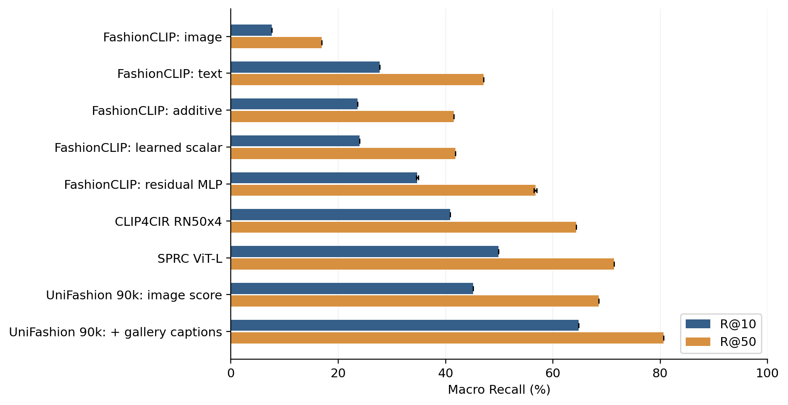

# Báo cáo tuần — So sánh baseline và các phương pháp CIR đã công bố

**Sinh viên:** Tô Quang Diệu — 523H0012.  
**Ngày tổng hợp:** 10/11/2026.  
**Nhiệm vụ:** Bổ sung so sánh baseline và các phương pháp mạnh đã công bố cho bài toán truy xuất ảnh thời trang có điều kiện trên FashionIQ, phục vụ hoàn thiện bài báo hội nghị.

Báo cáo tổng hợp lượt chạy Colab đã xuất trong `paper_comparison_evidence.zip`, được kiểm chứng khi chuẩn bị bản thảo ngày 05/11/2026; ngày tổng hợp không phải ngày chạy lại các mô hình. Không tự gán số tuần học kỳ. Phạm vi chỉ gồm phần thực nghiệm của sinh viên: baseline FashionCLIP, weighted-additive, residual MLP, UniFashion gốc, SPRC và CLIP4CIR. Không đưa kết quả attention-gate hoặc DeepFashion của thành viên còn lại vào báo cáo.

## 1. Mục tiêu và công việc đã thực hiện

Mục tiêu là khắc phục hạn chế so sánh chủ yếu với baseline additive, bổ sung mô hình CIR độc lập và làm rõ đóng góp của fine-tuning cùng tài nguyên caption gallery.

| Hạng mục | Kết quả |
|---|---|
| Chuẩn hóa giao thức so sánh | Cùng 6.016 query validation, gallery chính thức, loại reference và quy tắc xử lý hòa điểm |
| Kiểm soát ảnh đầu vào của baseline | Trích xuất lại FashionCLIP từ đúng các file ảnh đã kiểm tra dùng cho UniFashion |
| Baseline cơ bản | Hoàn tất image-only, text-only và fixed additive |
| Baseline có học | Hoàn tất weighted-additive và residual MLP, mỗi loại 3 seed |
| Mô hình từ công trình độc lập | Hoàn tất đánh giá checkpoint phát hành của SPRC ViT-L và CLIP4CIR RN50x4 fullft |
| Đối chứng trước fine-tuning | Hoàn tất UniFashion tại thời điểm khởi tạo cho CIR, với hai cách scoring |
| Đối chiếu checkpoint đã fine-tune | Tái sử dụng kết quả đã kiểm chứng của UniFashion gốc tại step 90.000 |
| Kiểm chứng và phân tích | Kiểm tra hash, coverage, rank, top-50; tính lại Recall và khoảng tin cậy bootstrap ghép cặp |

**Không huấn luyện lại UniFashion 10 epoch trong hạng mục này.** Kết quả checkpoint cuối được lấy từ lượt chạy gốc đã hoàn tất; SPRC và CLIP4CIR được chạy inference bằng checkpoint phát hành, không phải được huấn luyện từ đầu trong dự án.

## 2. Thiết lập thực nghiệm

### 2.1. Dữ liệu và cách tính metric

| Category | Train queries | Validation queries | Validation gallery |
|---|---:|---:|---:|
| dress | 5.985 | 2.017 | 3.817 |
| shirt | 5.988 | 2.038 | 6.346 |
| toptee | 6.027 | 1.961 | 5.373 |
| Tổng | 18.000 | 6.016 | 15.536 lượt ảnh theo category |

Gallery trong bảng là số lượng trước khi loại reference của từng query. Recall@K là tỷ lệ query có target được gán nhãn nằm trong top K; **macro Recall là trung bình đều ba category**. Mọi kết quả chính bên dưới dùng phần trăm; chênh lệch dùng điểm phần trăm (pp).

Tất cả mô hình dùng cùng query ID, raw modifier text, gallery chính thức và quy tắc xếp hạng: score giảm dần, hòa điểm thì theo thứ tự gallery. Không lọc bỏ query khó hoặc thiếu dự đoán. **Đây là full validation, không phải test**: annotation test hiện có không cung cấp target để tính Recall.

### 2.2. Mô hình và cấu hình

- **FashionCLIP:** checkpoint `patrickjohncyh/fashion-clip`, revision `7e3ba62ce16b379a1ab479346b66f192e76f51b7`; embedding 512 chiều, FP32. Baseline mới dùng cùng file ảnh nguồn với UniFashion, nhưng vẫn giữ preprocessing riêng của từng encoder.
- **Weighted-additive:** học một hệ số toàn cục cân bằng embedding ảnh và text. **Residual MLP:** học phép kết hợp phi tuyến trên embedding đóng băng, có 1.313.110 tham số. Cả hai chạy 15 epoch, batch 256, AdamW LR `1e-3`, weight decay `1e-4`, temperature `0.07`, seed 42/43/44; chọn epoch cuối, không chọn seed tốt nhất. Mỗi run có 1.050 update; bỏ batch cuối không đủ mẫu. Loss in-batch hiện chưa mask target trùng lặp.
- **CLIP4CIR:** checkpoint FashionIQ `RN50x4_fullft`, gồm encoder đã fine-tune và Combiner tương ứng; input 288 px.
- **SPRC:** checkpoint FashionIQ **ViT-L**, input 224 px. Không đồng nhất biến thể này với hàng full-model trong paper SPRC.
- **UniFashion:** giữ nguyên retrieval runtime của run gốc; EVA-G đóng băng. Đối chứng khởi tạo dùng domain-pretraining checkpoint và seed 42. Một số tham số retrieval được khởi tạo mới, nên không gọi đây là mô hình zero-shot CIR đã pretrained đầy đủ.
- **Môi trường:** các lượt comparison mới ghi nhận Tesla T4, PyTorch `2.11.0+cu128`, FP32; external-model evaluation batch 4. Run UniFashion gốc dùng FP32, batch 2, seed 42, 10 epoch/90.000 update và PyTorch `2.6.0+cu124`. Không coi hai nhóm là hoàn toàn giống môi trường phần mềm.

## 3. Kết quả so sánh trên full validation

### 3.1. Kết quả macro

| Phương pháp / checkpoint | Macro R@10 (%) | Macro R@50 (%) |
|---|---:|---:|
| FashionCLIP image-only | 7.59 | 16.92 |
| FashionCLIP text-only | 27.76 | 47.10 |
| FashionCLIP fixed additive | 23.62 | 41.54 |
| FashionCLIP weighted-additive, mean ± SD 3 seed | 23.98 ± 0.01 | 41.81 ± 0.01 |
| FashionCLIP residual MLP, mean ± SD 3 seed | 34.75 ± 0.22 | 56.75 ± 0.28 |
| CLIP4CIR RN50x4, checkpoint phát hành | 40.87 | 64.37 |
| SPRC ViT-L, checkpoint phát hành | 49.88 | 71.36 |
| UniFashion khởi tạo CIR, không score caption gallery | 26.79 | 46.71 |
| UniFashion khởi tạo CIR, cộng score caption gallery | 48.61 | 65.55 |
| UniFashion step90k, không score caption gallery | 45.14 | 68.53 |
| UniFashion step90k, cộng score caption gallery | 64.79 | 80.64 |

SD là độ lệch chuẩn mẫu giữa ba seed, không phải khoảng tin cậy. Các hàng còn lại là một checkpoint/khởi tạo cụ thể. Baseline image/text mới lần lượt là 7.59/16.92 và 27.76/47.10; các giá trị cache cũ 7.61/16.92 và 27.78/47.10 không được trộn vào bảng này.

### 3.2. Kết quả theo category

Mỗi ô là R@10 / R@50 (%). Hàng MLP là trung bình ba seed.

| Phương pháp | dress | shirt | toptee |
|---|---:|---:|---:|
| FashionCLIP fixed additive | 21.91 / 41.79 | 22.13 / 37.63 | 26.82 / 45.18 |
| FashionCLIP text-only | 24.34 / 44.67 | 26.01 / 42.93 | 32.94 / 53.70 |
| FashionCLIP residual MLP | 33.42 / 56.39 | 32.30 / 52.94 | 38.52 / 60.90 |
| CLIP4CIR RN50x4 | 33.86 / 59.00 | 43.87 / 64.82 | 44.88 / 69.30 |
| SPRC ViT-L | 43.88 / 66.48 | 51.72 / 71.98 | 54.05 / 75.62 |
| UniFashion step90k, không score caption | 39.46 / 65.34 | 48.09 / 67.27 | 47.88 / 72.97 |
| UniFashion step90k, cộng score caption | 65.20 / 80.66 | 61.24 / 77.58 | 67.92 / 83.68 |

## 4. Nhận xét và phân tích

### 4.1. Baseline mạnh hơn làm rõ chất lượng kết hợp hai modality

Text-only cao hơn fixed additive **4.14/5.56 pp**. Vì vậy, cộng hai embedding với trọng số bằng nhau chưa chắc tốt hơn chỉ dùng text trong thiết lập này. Weighted-additive chỉ cải thiện khoảng **0.36/0.28 pp** so với additive. Residual MLP đạt trung bình **34.75/56.75**, cao hơn additive **11.12/15.21 pp** và text-only **6.98/9.64 pp**. Kết quả ba seed cho thấy lợi ích nhất quán trong phạm vi các run này; không suy rộng độ ổn định đó sang UniFashion chỉ có một seed huấn luyện hoàn chỉnh.

### 4.2. So sánh độc lập không cho thấy UniFashion vượt mọi phương pháp

UniFashion step90k **không cộng score caption gallery** cao hơn CLIP4CIR **4.28/4.16 pp**, nhưng thấp hơn SPRC **4.74/2.83 pp**. SPRC mạnh hơn biến thể này ở cả ba category. Đây là kết quả cần trình bày đầy đủ, thay vì chỉ so UniFashion với additive yếu hơn.

Khi cộng score caption gallery, UniFashion đạt **64.79/80.64**, cao nhất trong các hệ thống thuộc phạm vi báo cáo, và cao hơn SPRC **14.90/9.28 pp**. Tuy nhiên, UniFashion lúc này có thêm tài nguyên mô tả từng sản phẩm trong gallery; đây không phải phép so sánh chỉ thay đổi kiến trúc với tài nguyên hoàn toàn ngang nhau.

### 4.3. Đóng góp của fine-tuning và caption gallery

| Phép so sánh, A trừ B | Δ R@10 (pp) | Δ R@50 (pp) |
|---|---:|---:|
| UniFashion step90k − khởi tạo CIR, không score caption | +18.36 | +21.82 |
| UniFashion step90k − khởi tạo CIR, có score caption | +16.17 | +15.09 |
| Có score caption − không score caption, cùng step90k | +19.64 | +12.11 |

Fine-tuning cải thiện rõ cả hai cách scoring từ khởi tạo đã xác định. Đối chứng này bao gồm việc học các tham số retrieval mới; không cô lập riêng tác động cập nhật trọng số pretrained.

**Cả hai biến thể UniFashion đều dùng ảnh reference và text chỉnh sửa làm query.** “Không score caption” chỉ bỏ thành phần score từ caption gallery, không có nghĩa là bỏ text khỏi query. Caption được dùng cho tất cả ứng viên, không dựa trên nhãn target để chọn caption đưa vào query.

Caption giúp thêm **1.337 query** vào top-10 nhưng làm **157 query** rời top-10 so với cùng checkpoint không score caption; ở top-50, các số tương ứng là 858 và 129. Như vậy, cải thiện tổng thể không đồng nghĩa cải thiện mọi truy vấn.

### 4.4. Khoảng tin cậy của một số chênh lệch

Đã tính 5.000 bootstrap ghép cặp theo query, phân tầng theo category, seed 42. Bảng là chênh lệch macro và khoảng percentile 95%, đơn vị pp.

| A − B | Δ R@10 [95% CI] | Δ R@50 [95% CI] |
|---|---:|---:|
| Text-only − additive | 4.14 [2.76, 5.54] | 5.56 [3.99, 7.04] |
| SPRC − UniFashion step90k không score caption | 4.74 [3.58, 5.89] | 2.83 [1.82, 3.88] |
| UniFashion step90k có − không score caption | 19.64 [18.51, 20.80] | 12.11 [11.14, 13.11] |

Các khoảng này có điều kiện trên checkpoint và gallery đã đánh giá; chưa tính phụ thuộc giữa query dùng chung ảnh, chưa phản ánh biến thiên seed huấn luyện và không khắc phục việc validation đã được dùng chọn checkpoint/cấu hình.

## 5. Đối chiếu số liệu công bố và giới hạn kết luận

Bảng dưới là **số liệu từ bài báo gốc**, không phải kết quả chạy bằng evaluator của dự án. “SOTA comparison” trong hạng mục này gồm đánh giá các phương pháp mạnh đã công bố và đối chiếu tài liệu; không có nghĩa đã khảo sát toàn bộ SOTA mới nhất hoặc đạt kỷ lục mới.

| Phương pháp / biến thể trong paper | R@10 (%) | R@50 (%) | Nguồn |
|---|---:|---:|---|
| CLIP4CIR RN50x4 | 43.78 | 66.93 | [CLIP4CIR, Table 9](https://arxiv.org/html/2308.11485v1) |
| SPRC full-model | 54.92 | 74.97 | [SPRC, Table 1](https://proceedings.iclr.cc/paper_files/paper/2024/file/8204f54f6cd8f0db1765a274e94ceaac-Paper-Conference.pdf) |
| UniFashion không caption | 55.27 | 74.80 | [UniFashion, Table 4](https://aclanthology.org/2024.emnlp-main.89.pdf) |
| UniFashion đầy đủ | 58.93 | 76.93 | [UniFashion, Table 4](https://aclanthology.org/2024.emnlp-main.89.pdf) |
| QuRe BLIP-2 ViT-L | 52.60 | 73.48 | [QuRe, Tables 2/7](https://arxiv.org/html/2507.12416v1) |

QuRe chưa được chạy trong dự án. SPRC local là ViT-L, không phải hàng full-model nêu trên. External-model evaluation dùng cách nối raw text, ảnh resized và reference exclusion của dự án; khác native protocol của tác giả. Gallery-caption scoring của UniFashion dùng caption phát hành sẵn, chưa xác nhận tương đương chính xác quy trình tạo caption trong paper. Vì thế, **không dùng 64.79/80.64 để tuyên bố vượt SOTA hoặc tái lập chính xác điểm UniFashion công bố**.

Các giới hạn còn lại: validation đã được dùng theo dõi/chọn mô hình; pretraining và ngân sách huấn luyện giữa các hệ thống khác nhau; cùng file ảnh nguồn nhưng transform khác nhau; audit gallery ghi nhận một số overlap train/val chéo category. Các phép kiểm chứng artifact không thay thế một lượt tái lập inference độc lập.

## 6. Minh chứng và mã nguồn

ZIP nguồn có SHA-256:

`0a4ca91adbc735927846d9be625f50fb8e14b1eec3d05a140d95da0925b40e86`

Biên bản kiểm chứng ghi nhận **64 file trong manifest khớp hash**, **17 biến thể dự đoán đủ 6.016 query**, không sai lệch giữa summary và rank/hit đã xuất. Bốn biến thể gate được loại khỏi phạm vi báo cáo; còn 13 biến thể mới được sử dụng. XML Colab ghi nhận **17 tests đạt**; đây là kết quả xuất từ Colab, không phải một lượt GPU test mới tại local. UniFashion step90k lấy từ minh chứng lịch sử đã kiểm tra riêng.

**Tệp kết quả cần dùng cùng báo cáo:**

- [Bảng Recall đầy đủ đã kiểm chứng](../../papers/fashion_search/evidence/verified_results.csv).
- [Mean và SD của các seed](../../papers/fashion_search/evidence/seed_summary.csv).
- [Khoảng tin cậy ghép cặp](../../papers/fashion_search/evidence/paired_intervals.csv).
- [Số query cải thiện/suy giảm](../../papers/fashion_search/evidence/query_transitions.csv).
- [Biên bản kiểm chứng và provenance từng kết quả](../../papers/fashion_search/evidence/verification.json).
- [Biểu đồ so sánh](../../papers/fashion_search/figures/main_comparison.png).

**Link code kiểm chứng** — các URL dưới đây trỏ đến mã nguồn đi kèm báo cáo trên nhánh `main`:

· Link notebook chạy các comparison:  
[github.com/okok0814/khoaluantotnghiep/blob/main/notebooks/45_11_Conference_Comparisons.ipynb](https://github.com/okok0814/khoaluantotnghiep/blob/main/notebooks/45_11_Conference_Comparisons.ipynb)

· Link code trích xuất baseline trên cùng file ảnh:  
[github.com/okok0814/khoaluantotnghiep/blob/main/scripts/extract_paper_fashionclip.py](https://github.com/okok0814/khoaluantotnghiep/blob/main/scripts/extract_paper_fashionclip.py)

· Link code huấn luyện weighted-additive/MLP:  
[github.com/okok0814/khoaluantotnghiep/blob/main/scripts/run_fashionclip_controls.py](https://github.com/okok0814/khoaluantotnghiep/blob/main/scripts/run_fashionclip_controls.py)

· Link code đánh giá SPRC, CLIP4CIR và UniFashion khởi tạo:  
[github.com/okok0814/khoaluantotnghiep/blob/main/scripts/evaluate_paper_models.py](https://github.com/okok0814/khoaluantotnghiep/blob/main/scripts/evaluate_paper_models.py)

· Link adapter nạp đúng biến thể/checkpoint:  
[github.com/okok0814/khoaluantotnghiep/blob/main/src/paper_model_adapters.py](https://github.com/okok0814/khoaluantotnghiep/blob/main/src/paper_model_adapters.py)

· Link code kiểm chứng ZIP và tạo bảng theo phạm vi bài báo:  
[github.com/okok0814/khoaluantotnghiep/blob/main/papers/fashion_search/scripts/prepare_evidence.py](https://github.com/okok0814/khoaluantotnghiep/blob/main/papers/fashion_search/scripts/prepare_evidence.py)

## 7. Kết quả đạt được và kế hoạch tiếp theo

Đã bổ sung baseline có học, đối chứng khởi tạo và **hai mô hình CIR độc lập được chạy thực tế trên full validation**. Nhờ đó, phần so sánh không còn chỉ dựa vào additive và số liệu trích từ paper. Các phương pháp dùng chung giao thức dự án; kết quả đã đủ để viết bảng so sánh cùng phần phân tích có giới hạn rõ ràng trong bản thảo hội nghị.

Tiếp theo: hoàn thiện mô tả tài nguyên caption và khác biệt với native protocol; nếu có ngân sách, bổ sung caption-score-only và phân tích overlap/seed; thống nhất template hội nghị với giảng viên. Phần attention-fusion của teammate sẽ được báo cáo riêng khi có checkpoint và kết quả cùng giao thức, không điền số liệu thay thế từ một mô hình khác.

### Đoạn tóm tắt có thể đưa trực tiếp vào báo cáo nộp

Trong hạng mục này, sinh viên đã mở rộng đánh giá hệ thống truy xuất ảnh thời trang có điều kiện trên toàn bộ 6.016 truy vấn validation của FashionIQ. Các thí nghiệm bổ sung gồm trích xuất lại FashionCLIP từ cùng file ảnh nguồn, các baseline image-only/text-only/additive, weighted-additive và residual MLP với ba seed, cùng đánh giá checkpoint phát hành của CLIP4CIR RN50x4 và SPRC ViT-L. Residual MLP đạt macro Recall@10/Recall@50 trung bình 34,75%/56,75%, cao hơn additive 23,62%/41,54%. CLIP4CIR và SPRC lần lượt đạt 40,87%/64,37% và 49,88%/71,36%. UniFashion đã fine-tune tại step 90.000 đạt 45,14%/68,53% khi không cộng score caption gallery, thấp hơn SPRC; khi cộng score caption gallery đạt 64,79%/80,64%. Đối chứng khởi tạo cho thấy fine-tuning cải thiện cả hai cách scoring. Kết quả được kiểm tra bằng hash, dự đoán từng query và tính lại Recall; các chênh lệch chính được phân tích bằng bootstrap ghép cặp. Công việc đã bổ sung so sánh thực nghiệm với mô hình độc lập cho bài báo, nhưng chưa đủ cơ sở tuyên bố vượt SOTA do khác biệt tài nguyên caption, preprocessing, cấu hình và giao thức so với số liệu công bố.
