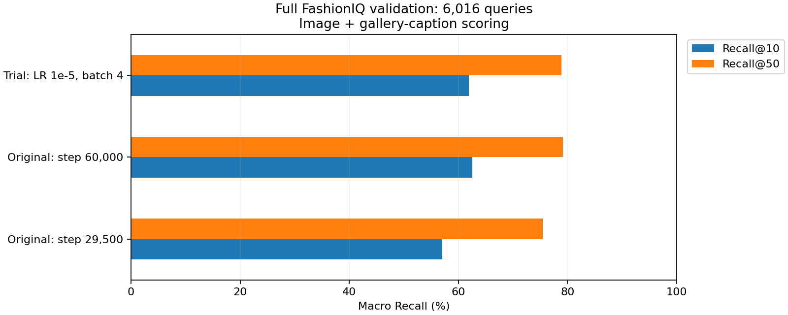

# Báo cáo cập nhật — Xác nhận tuning và lựa chọn checkpoint UniFashion

Cập nhật **27/10/2026** từ `tuning_evidence.zip`. **Ba trial, screening và full validation của base cùng ứng viên đã hoàn thành. Trial được shortlist không cải thiện trên full validation; giữ checkpoint base step 60.000.**

## Kiểm tra minh chứng

ZIP gốc và 78 file giải nén được giữ trong [evidence_completed_20261027](evidence_completed_20261027/), không sửa nội dung gốc. Đã kiểm tra CRC ZIP, hash input study, query/text/gallery, target rank/hit/top-50, reference exclusion trong top-50, quan hệ parent/trial và ngân sách 1.200 ví dụ.

Đã tính lại Recall từng category, macro/micro từ CSV rank cho **12 kết quả**: 4 checkpoint screening × 2 scoring và 2 checkpoint full-val × 2 scoring. Mỗi kết quả full-val có đủ **6.016 query**; các số tính lại khớp JSON/bảng xuất từ Colab. CSV training ba trial có đầy đủ 600, 600, 300 update, cùng 1.200 ví dụ. Hash checkpoint nhất quán giữa screening và full-val; fingerprint training của base khớp run gốc tại step 29.500.

Biên bản: [full_evidence_verification.json](full_evidence_verification.json). Đây là kiểm tra minh chứng, không phải GPU rerun độc lập; ZIP không chứa trọng số hoặc toàn bộ score matrix. Runtime ghi trong kết quả là UniFashion gốc, không phải attention-fusion được tích hợp vào GitHub sau đó.

Báo cáo khi hết quota ngày 20/10 được giữ tại [bản lưu tiến độ](notebook_evidence/weekly_report_as_of_20261020.md). ZIP mới chứa kết quả các lượt chạy tiếp; không sửa output notebook cũ để giả lập kết quả mới.

## Thiết kế và screening

Parent FP32 tại **60.000 update**, 6 epoch hoàn tất + 6.000 batch epoch 7; seed 42, Tesla T4. Ba trial khởi tạo AdamW mới, LR cố định, dùng cùng 1.200 ví dụ. LR kế tiếp của OneCycle trong parent là khoảng 6,6761e-6. Batch 2 có 600 update, batch 4 có 300; ngân sách bằng nhau theo số ví dụ, không theo số update.

Screening dùng 192 query, 64/category, gallery 512/category. Tiêu chí chọn cố định trước là trung bình macro R@10 và R@50 với score caption gallery.

| Cấu hình | R@10 (%) | R@50 (%) | Mean R (%) |
|---|---:|---:|---:|
| Base step 60.000 | 88,02 | 96,35 | 92,19 |
| LR 1e-5, batch 2 | 87,50 | 95,83 | 91,67 |
| LR 5e-6, batch 2 | 87,50 | 96,35 | 91,93 |
| LR 1e-5, batch 4 | 90,10 | 95,31 | **92,71** |

Batch 4 được shortlist nhờ Mean R tăng 0,52 pp, mặc dù R@50 giảm. `report/selection.json` trong ZIP chỉ là **lựa chọn sau screening**, không phải kết luận tốt nhất sau full validation.

## Full validation và quyết định

Giao thức giống lượt trước: dress 2.017 query/3.817 gallery, shirt 2.038/6.346, toptee 1.961/5.373; tổng 6.016 query, loại reference, cùng raw text/caption gallery. FP32, eval batch 4, không ITM reranking.

| Checkpoint, scoring có caption gallery | Macro R@10 (%) | Macro R@50 (%) | Mean R (%) |
|---|---:|---:|---:|
| Step 29.500 — kết quả trước | 57,08 | 75,43 | 66,25 |
| **Base step 60.000** | **62,57** | **79,18** | **70,88** |
| Step 60.000 + LR 1e-5/batch 4, 300 update | 61,88 | 78,88 | 70,38 |



Trial giảm **0,69 pp R@10**, **0,30 pp R@50**, **0,50 pp Mean R** so với parent. **Giữ base step 60.000.** Đây là tuning chưa cải thiện trong ngân sách/seed đã thử, không phải lỗi thực thi. Hai trial batch 2 chưa được đo full-val nên không kết luận chúng kém hơn base trên full-val.

Base step 60.000 tăng **5,50 / 3,75 pp** so với step 29.500. Mức tăng thuộc hai checkpoint của run huấn luyện gốc; không quy cho tuning LR/batch bắt đầu sau step 60.000.

| Category | Base R@10 / R@50 (%) | Trial batch 4 R@10 / R@50 (%) |
|---|---:|---:|
| dress | 62,37 / 78,48 | 61,68 / 79,03 |
| shirt | 59,62 / 76,30 | 59,62 / 75,76 |
| toptee | 65,73 / 82,76 | 64,35 / 81,85 |

Scoring **không cộng caption gallery**: base **41,16% / 64,73%**, trial **40,24% / 63,66%**; trial cũng thấp hơn theo macro cả hai metric. Hai scoring đều dùng query ảnh reference + mô tả, không phải image-only query. Xem [verified_recall.csv](verified_recall.csv) và [checkpoint_comparison.csv](checkpoint_comparison.csv).

## Phân tích theo query

Với scoring có caption gallery:

| K | Cả hai đúng | Chỉ trial đúng | Chỉ base đúng | Cả hai sai |
|---|---:|---:|---:|---:|
| 10 | 3.554 | 167 | 208 | 2.087 |
| 50 | 4.625 | 118 | 136 | 1.137 |

Trial có ít hơn base **41 hit top-10** và **18 hit top-50**. Đây là chênh lệch hit trên 6.016 query; metric chính dùng macro trung bình đều ba category. Chi tiết: [full_validation_transitions.csv](full_validation_transitions.csv). Chưa kiểm định độ tin cậy/chạy nhiều seed nên không kết luận mức giảm có ý nghĩa thống kê.

## Đối chiếu paper và giới hạn

Mốc paper đã ghi trong [hướng dẫn](../../docs/Week10_UniFashion_Tuning.md) là 58,93% / 76,93%. Base hiện cao hơn **về số học** 3,64 / 2,25 pp, nhưng không chứng minh vượt paper: protocol/text/caption gallery/batch/precision khác nhau và validation đã dùng chọn cấu hình. Không so điểm screening với paper. **Không tuyên bố tuning thu hẹp khoảng cách**, vì trial giảm so với parent trong phép so sánh hiện tại.

## Checkpoint cần giữ và nhiệm vụ tuần này

[best_checkpoint_selection.json](best_checkpoint_selection.json) ghi lựa chọn **parent step 60.000**, SHA-256 `df8226a0e61e41ebb5bf88f1870b0176118f75d14612ceb8c0e04cf91309a683`, theo mean macro Recall@10/@50 có caption gallery. Đây là **tốt nhất trong ba checkpoint đã có full validation trong bảng**, không phải tốt nhất trên mọi epoch.

File cần giữ trên Drive:

```text
MyDrive/Thesis/UniFashion/week8/tuning/fp32_lr_batch_01/parent_snapshot.pt
```

Không chọn `trials/lr1e5_b4/trial.pt` chỉ vì tên trial còn nằm trong shortlist. `last.pt` là checkpoint mới nhất; `best_monitor.pt` chọn theo monitor loss; cả hai không tự đồng nghĩa tốt nhất theo Recall.

Người chạy báo run gốc **epoch 9, step 78.000**. ZIP này không chứng minh tiến độ đó; nếu đúng mốc đã lưu và 9.000 update/epoch thì còn **12.000 update** để hoàn tất 10 epoch/90.000 step. Nhiệm vụ “hoàn tất huấn luyện; lưu checkpoint tốt nhất” **vẫn đang thực hiện**:

1. Giữ riêng parent step 60.000; sao chép và kiểm tra SHA-256 theo [hướng dẫn tuần 43](../../docs/Week43_UniFashion_Checkpoint_Selection.md).
2. Resume run gốc từ `last.pt` bằng code ZIP/config gốc, không thay runtime bằng attention-fusion trên main.
3. Khi đạt 90.000 step, tạo snapshot mới và đánh giá cùng protocol; chỉ thay checkpoint được chọn nếu tiêu chí đã định tăng. Nếu không, giữ step 60.000.

Đã xác định checkpoint theo kết quả nhưng **chưa trực tiếp tạo hoặc xác minh bản sao trọng số “best” trên Drive**. File JSON lựa chọn không thay thế file checkpoint.

## Đoạn có thể dùng trong báo cáo

> Nhóm đã hoàn tất các trial tinh chỉnh learning rate/batch size và xác nhận trên toàn bộ 6.016 truy vấn validation cho checkpoint gốc tại step 60.000 cùng ứng viên LR 1e-5, batch 4. Checkpoint gốc đạt macro Recall@10/Recall@50 là 62,57%/79,18%, trong khi ứng viên đạt 61,88%/78,88%. Mặc dù ứng viên có điểm screening cao hơn, kết quả full validation giảm lần lượt 0,69 và 0,30 điểm phần trăm, nên nhóm giữ checkpoint gốc làm mốc tốt nhất trong các checkpoint đã đánh giá. Quá trình huấn luyện đầy đủ hiện được người chạy ghi nhận tại step 78.000/90.000; nhóm tiếp tục hoàn tất huấn luyện, bảo toàn checkpoint đã chọn và đánh giá snapshot cuối trước khi quyết định checkpoint bàn giao.
