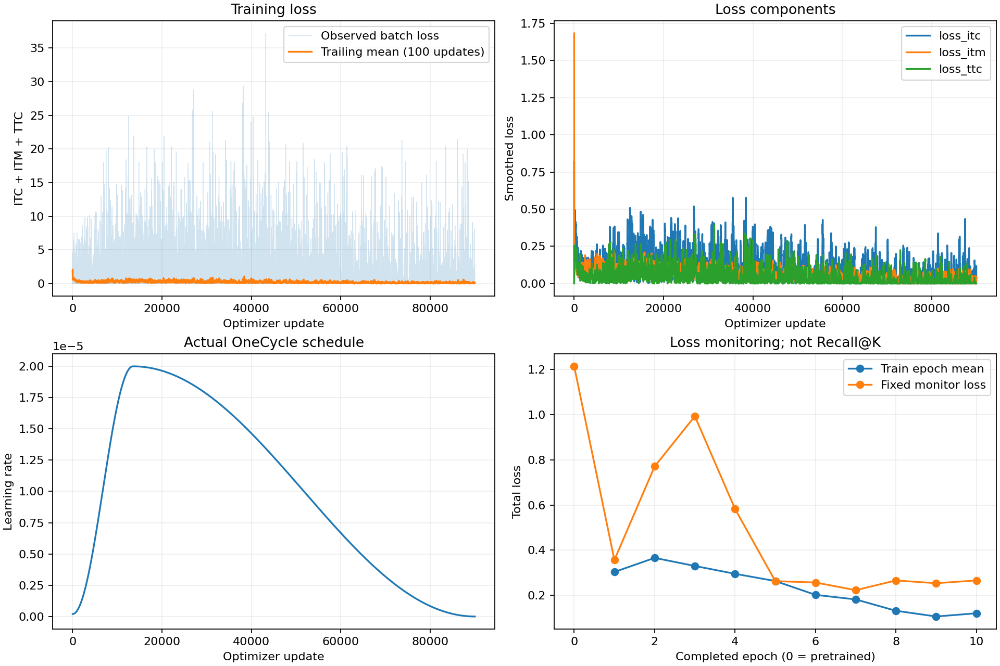
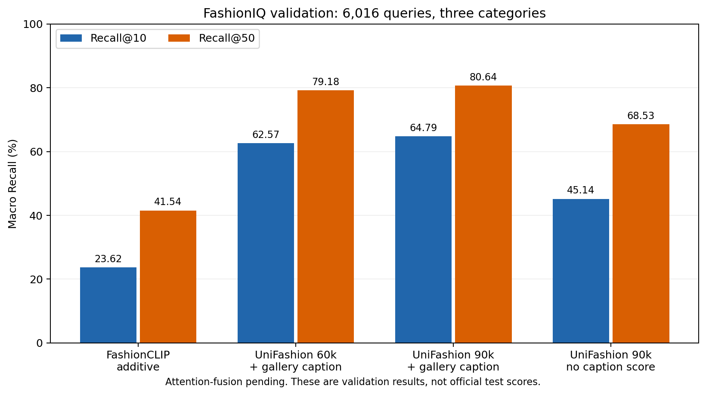

# Báo cáo gộp tuần 43–44: hoàn tất UniFashion, lưu checkpoint và so sánh Recall

Nhiệm vụ: (1) hoàn tất huấn luyện và lưu checkpoint tốt nhất; (2) so sánh baseline additive, UniFashion fine-tune và attention-fusion bằng Recall@10/@50.

**Phạm vi hiện tại là validation, không phải test chính thức.** Dữ liệu local có 6.118 test query nhưng toàn bộ target bị ẩn; chưa thể tính test Recall. Cần thống nhất phạm vi với giảng viên hoặc có cơ chế đánh giá test chính thức. Không đổi tên validation thành test.

| Hạng mục | Trạng thái |
|---|---|
| Hoàn tất huấn luyện mô hình gốc | Hoàn tất 10 epoch / 90.000 update |
| Lưu checkpoint tốt nhất trong các ứng viên đã đánh giá | Hoàn tất, đã nhận receipt copy/hash/CPU reload |
| Baseline additive và UniFashion trên validation | Đã kiểm tra đủ 6.016 query, gồm checkpoint cuối |
| Attention-fusion trên cùng giao thức | Chưa có kết quả |
| So sánh đủ ba mô hình trên test chính thức | Chưa hoàn tất; thiếu nhãn test |

## 1. Minh chứng hoàn tất huấn luyện

ZIP do người chạy cung cấp xác nhận run gốc `full_train_fp32_b2_seed42` hoàn tất **10/10 epoch, 90.000 optimizer update, 180.000 lượt ví dụ**. Mỗi epoch có 18.000 query, batch 2, 9.000 update và không bỏ mẫu. Đã kiểm tra thứ tự step/batch, các giá trị hữu hạn, tính lại loss từng epoch và đối chiếu fingerprint với run gốc đã đánh giá tại step 60.000.

Cấu hình: FP32, seed 42, AdamW max LR 2e-5, OneCycle 10 epoch, EVA-G đóng băng; Tesla T4, PyTorch 2.6.0+cu124. Monitor là 96 query cố định, khác full validation 6.016 query.

| Epoch | Step | Train loss | Monitor loss |
|---:|---:|---:|---:|
| 1 | 9000 | 0.303700 | 0.356786 |
| 2 | 18000 | 0.366083 | 0.770699 |
| 3 | 27000 | 0.330310 | 0.993188 |
| 4 | 36000 | 0.295580 | 0.582520 |
| 5 | 45000 | 0.263618 | 0.263252 |
| 6 | 54000 | 0.202468 | 0.257138 |
| 7 | 63000 | 0.182144 | 0.223193 |
| 8 | 72000 | 0.131991 | 0.266174 |
| 9 | 81000 | 0.106700 | 0.254015 |
| 10 | 90000 | 0.120989 | 0.266318 |

Monitor loss thấp nhất: **0.223193 ở epoch 7**. `best_monitor.pt` được chọn theo loss; không suy ra đây là checkpoint tốt nhất theo Recall. Train loss giảm so với giai đoạn đầu nhưng tăng nhẹ từ epoch 9 sang epoch 10; chưa có cơ sở kết luận hội tụ hay chất lượng truy xuất của checkpoint cuối từ loss.

Tổng thời gian các update được ghi là 29.89 giờ; không phải tổng GPU/wall-clock cost vì chưa gồm setup, validation, lưu checkpoint và các bước chạy lại. XML trong ZIP training ghi nhận 16 tests đã đạt tại môi trường Colab; đây là kết quả kiểm thử được xuất, không phải một lượt GPU test mới tại máy local.

## 2. Lựa chọn checkpoint theo Recall

| Checkpoint gốc | Macro R@10 (%) | Macro R@50 (%) | Mean R (%) |
|---|---:|---:|---:|
| step60000 | 62.57 | 79.18 | 70.88 |
| step90000 | 64.79 | 80.64 | 72.71 |

Checkpoint được chọn trong các ứng viên đã đo: **step90000**. Tiêu chí cố định: mean macro R@10/R@50 với score caption gallery; hòa thì giữ step60000. Không đưa attention-fusion vào cùng quyết định vì đó là mô hình khác.

Đã có receipt xác minh hash bản sao và nạp lại checkpoint trên CPU. Checkpoint/source và hash được lưu trong `checkpoint_copy.json`.

Step90000 so với step60000: R@10 +2.21, R@50 +1.46, mean R +1.84 điểm phần trăm. Đây là so sánh hai snapshot của cùng run, không phải kết quả của trial tuning.

**Phạm vi lựa chọn:** step60000 và step90000; chưa đánh giá Recall ở mọi epoch, nên không khẳng định checkpoint này tốt nhất trong toàn bộ quá trình huấn luyện.

Bản checkpoint được receipt ghi nhận trên Drive:

`/content/drive/MyDrive/Thesis/UniFashion/week8/selected_checkpoints/completion/best_recall_step90000.pt`

SHA-256: `1b41d1f442785030c51148b0538097b17fd1aec8b3d7653c0b4829adf448b9e5`.

Receipt xác nhận bản sao có hash trùng nguồn và deserialize thành công trên CPU ở Colab. ZIP chỉ chứa minh chứng, không chứa weights; không thực hiện nạp weights hay inference GPU lại tại local.

## 3. So sánh các mô hình trên full validation

Cùng 6.016 query: dress 2.017/3.817 gallery, shirt 2.038/6.346, toptee 1.961/5.373. Loại reference khỏi ranking, cùng raw text và gallery caption cho các biến thể UniFashion; macro là trung bình đều ba category. Baseline được tái sử dụng từ kết quả đã đo và kiểm tra lại rank; không tuyên bố chạy inference baseline mới.

| Mô hình / checkpoint | Category | R@10 (%) | R@50 (%) |
|---|---|---:|---:|
| FashionCLIP additive | dress | 21.91 | 41.79 |
| FashionCLIP additive | shirt | 22.13 | 37.63 |
| FashionCLIP additive | toptee | 26.82 | 45.18 |
| FashionCLIP additive | MACRO | 23.62 | 41.54 |
| UniFashion step60000 + caption | dress | 62.37 | 78.48 |
| UniFashion step60000 + caption | shirt | 59.62 | 76.30 |
| UniFashion step60000 + caption | toptee | 65.73 | 82.76 |
| UniFashion step60000 + caption | MACRO | 62.57 | 79.18 |
| UniFashion step60000 no caption score | dress | 34.46 | 59.54 |
| UniFashion step60000 no caption score | shirt | 43.13 | 64.38 |
| UniFashion step60000 no caption score | toptee | 45.89 | 70.27 |
| UniFashion step60000 no caption score | MACRO | 41.16 | 64.73 |
| UniFashion step90000 + caption | dress | 65.20 | 80.66 |
| UniFashion step90000 + caption | shirt | 61.24 | 77.58 |
| UniFashion step90000 + caption | toptee | 67.92 | 83.68 |
| UniFashion step90000 + caption | MACRO | 64.79 | 80.64 |
| UniFashion step90000 no caption score | dress | 39.46 | 65.34 |
| UniFashion step90000 no caption score | shirt | 48.09 | 67.27 |
| UniFashion step90000 no caption score | toptee | 47.88 | 72.97 |
| UniFashion step90000 no caption score | MACRO | 45.14 | 68.53 |

Checkpoint cuối có caption đạt macro 64,79%/80,64%, cao hơn baseline additive 41,16/39,10 điểm phần trăm. Bỏ score caption gallery còn 45,14%/68,53%; chênh lệch do thêm score caption là 19,64/12,11 điểm phần trăm.

**Giải thích ablation:** cả hai biến thể UniFashion vẫn dùng ảnh reference và text chỉnh sửa làm query; “no caption score” chỉ bỏ thành phần score caption của gallery, không phải image-only query.

Lượt evaluation ghi nhận 81.10 phút cho cả hai scoring; không cộng thời gian setup, kiểm tra và sao chép checkpoint ngoài lượt này.

**Attention-fusion: chưa có kết quả cùng giao thức.** Theo cập nhật mới nhất của người chạy, teammate chưa hoàn tất run dự định dùng. Không lấy điểm của gate FashionCLIP độc lập hoặc notebook cũ để điền vào hàng UniFashion + attention-fusion. Bổ sung checkpoint và full-validation JSON/CSV khi sẵn sàng.

## 4. Giới hạn và phần còn lại

- Huấn luyện gốc đã hoàn tất; không cần train lại hoặc chạy lại tuning.
- Đã đo checkpoint cuối.
- Đã nhận receipt bảo toàn checkpoint.
- Chờ teammate hoàn tất và đánh giá attention-fusion.
- Validation đã dùng lựa chọn checkpoint, không phải test độc lập. Baseline cache chưa được đối chiếu hoàn toàn pixel ảnh nguồn với run hiện tại.
- Điểm cao hơn paper về số học không chứng minh vượt paper vì protocol/caption/preprocessing khác nhau.
- Minh chứng kiểm tra log/rank không thay thế chạy lại mô hình độc lập.

## 5. Đoạn tóm tắt báo cáo

Nhóm đã hoàn tất huấn luyện UniFashion trên FashionIQ với 10 epoch và 90.000 bước cập nhật ở cấu hình FP32, batch size 2. Minh chứng xuất từ Colab được kiểm tra tính liên tục và nhất quán với các checkpoint trước. Trên toàn bộ 6.016 truy vấn validation, checkpoint cuối đạt macro Recall@10 là 64,79% và Recall@50 là 80,64%, thay đổi 2,21 và 1,46 điểm phần trăm so với step 60.000 khi sử dụng score caption gallery. Nhóm chọn step90000 theo mean macro Recall trong hai ứng viên đã đánh giá. Bản checkpoint tốt nhất đã được lưu riêng trên Drive, xác minh SHA-256 và nạp lại trên CPU theo receipt xuất từ Colab. Kết quả attention-fusion sẽ được bổ sung sau khi teammate hoàn tất run. Các kết quả hiện có thuộc tập validation; chưa báo cáo test Recall do dữ liệu test không có nhãn target.

## 6. Minh chứng đã kiểm tra

Nhận ZIP ngày 2026-11-02; SHA-256 `2569761726effc89a18ae83e7dd4ea4f8e46c50c95396219271c929f2702a805`. Kiểm tra CRC ZIP, coverage/rank/hit và tính lại Recall của cả hai scoring từ CSV; đối chiếu protocol, fingerprint, config, snapshot và receipt bản best. Các bảng và quyết định chọn checkpoint tái tạo khớp bản xuất Colab.

Lượt kiểm thử trước evaluation trong ZIP ghi nhận **10 tests đạt**, khác bộ 16 tests của training. Không có lỗi, thất bại hay test bỏ qua trong XML này.

- [Raw evaluation status](evidence_completed_20261102/final_results/status.json)
- [Kết quả có caption](evidence_completed_20261102/final_results/unifashion_image_caption_score.json)
- [Kết quả không score caption](evidence_completed_20261102/final_results/unifashion_image_score.json)
- [Quyết định chọn checkpoint](checkpoint_selection.json)
- [Receipt sao chép checkpoint](checkpoint_copy.json)
- [Bảng so sánh CSV](model_comparison.csv)
- [Hash các file minh chứng](evidence_import.json)

File `training_status.json` vẫn ghi `retrieval_evaluated: false` vì nó mô tả bước training. Evaluation chạy riêng; trạng thái hoàn tất nằm trong `final_results/status.json`. Hai file `_partial.csv` trong ZIP đã trùng nội dung với `_per_query.csv`; giữ lại nguyên bản minh chứng.
